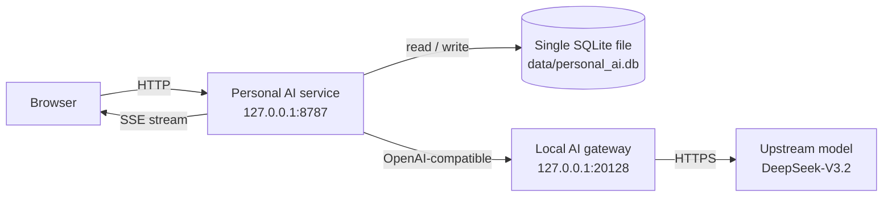
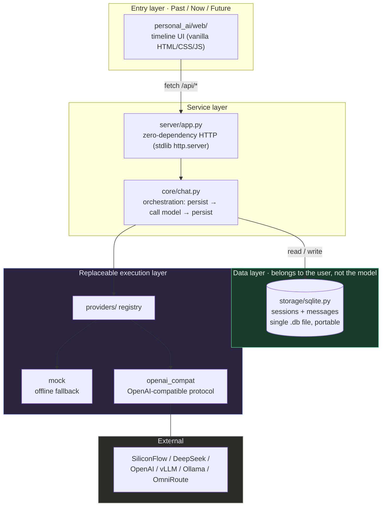

# Personal AI

> Full Chinese version: **[README.zh-CN.md](README.zh-CN.md)**

**One line: an AI entry point that runs on your own machine — conversations, tasks and history live locally, the model can be swapped at any time, and every reply shows where it came from.**

> ### How I work
>
> **Let the goal create the asset; let the understanding compound on the asset.**
>
> This repository is the first product of that sentence. It did not start as "I want to
> learn AI" — it was forced into existence by one goal: *"I need my own AI entry point."*
> Keeping that entry point alive long-term is what produced pluggable providers,
> self-owned data, automated regression tests, and that operations document.

> ### How I verify
>
> **Before anything is handed over, prove that a machine can read it and a machine can run it.**
>
> That sentence has three proofs in this repository. Two test layers
> (31 unit tests + 32 smoke tests) are wired into CI and run automatically on four
> combinations: Ubuntu/Windows × Python 3.11/3.13.
> Every row of the "symptom → cause → action" troubleshooting table in the operations
> document is a failure that actually happened. And the PDFs shipped externally were
> passed through an inspector first — confirming a machine could extract text — before
> anyone received them (the inspector lives in a separate repo, `pdf-delivery-audit`).



**What it looks like running** — note the line above every reply: that is the real
provenance chain of that answer, not decoration.


**Operations view** (how to deploy, how to monitor, what to check first when something
breaks): see **[docs/OPERATIONS.md](docs/OPERATIONS.md)**.

> My unified AI entry point and personal AI data layer.
> History, Memory, Task and project context **belong to me** — not to any model vendor.
> Model / Agent / Provider are **three replaceable layers**.

Permanent time skeleton: **Past · Now · Future**.

---

> **How this was built**: the code in this repository was produced by the designer
> working with AI coding assistants — the designer defines requirements, sets the
> acceptance criteria and verifies each result; the AI generates the code.
> Every number in this document was measured on real hardware. Anything not yet
> measured is explicitly labelled as such.

## Current status (stated honestly, not exaggerated)

| Capability | Status |
|---|---|
| Backend service (zero third-party dependencies) | ✅ Implemented |
| Pluggable providers (registry pattern) | ✅ Implemented; `mock` + `openai_compat` wired up |
| History persistence (SQLite) | ✅ Implemented; single file, copy it and go |
| Source transparency (replies carry the real call chain) | ✅ Implemented |
| Past / Now / Future time-skeleton UI | ✅ Connected to real APIs (A3) |
| **Future zone (Task)** | ✅ Done (A4): create, advance state, delete — all driven by real data |
| Automated tests | ✅ 32/32 passing (`python scripts/smoke_test.py`) |
| **Real model call** | ✅ **Verified 2026-10-06** — via local AI gateway → SiliconFlow → `deepseek-ai/DeepSeek-V3.2`; measurements below under "Verifiable evidence" |
| **Streaming output (SSE — replies render chunk by chunk like ChatGPT)** | ✅ Done (A5): 16–33 incremental chunks measured on a real model; first chunk 1.6s (warm) |
| Memory / Task (future zone) | ⛔ Not implemented; visual placeholder only |
| Multi-device sync | ⛔ Not implemented |

The `mock` provider is an **explicitly labelled** offline fallback: replies start with
`[mock]`, the call chain reads `mock → mock-offline`, and the UI states that no real
model call was made. It does not pretend.

---

## Iteration log

> This repository was not written in one pass. Below are the occasions where something
> turned out to be wrong and got fixed. They are kept because **one properly diagnosed
> failure says more than ten clean commits.**

### Windows CI all red: first blamed the environment, then myself

After wiring both test layers into CI, this happened: **green on Ubuntu, red on Windows.**

The first instinct was to blame the environment — "the CI Windows machine is not the same
as mine." I chased that difference and found nothing. Then I went back and read the actual
error: **a command I had written contained a non-ASCII character, and the Windows shell
mangled it.** Not the environment's fault. The code's fault.

Fix: make that command ASCII-only and pin `PYTHONIOENCODING=utf-8`
(commit `dbc7ba4` — the commit title is the fix, verifiable on the commits page).

The habit adopted since: **do not attribute by feeling; measure first, conclude second.**
CI covers Ubuntu + Windows × Python 3.11/3.13 — four combinations. As of this section,
the latest push (`8eb284e`) finished with all four jobs green; each run is inspectable
on the Actions page.

> First draft of this section was assembled by an AI assistant from the commit history.
> Following the rule "the author does not review their own work", it is independently
> reviewed by a second AI assistant before the designer publishes it.

---

## Quick start

Zero third-party dependencies. Any Python 3.9+ runs it; `pip install` nothing.

**Measured environment** (combinations not tested are not claimed): Windows 11 + Python
3.11 / 3.13. Linux and macOS were not validated on real hardware; CI runs
ubuntu-latest and windows-latest.

```bash
python -m personal_ai --serve          # offline mode (mock provider, no real model call)
python scripts/start_local.py          # one-shot start, auto-connects to the local OmniRoute gateway
```

Open <http://127.0.0.1:8787>

`start_local.py` checks whether the gateway is running and reads the existing local
gateway key (read-only — it never creates or modifies configuration). The key exists
only inside the process and is never written to a file.

```bash
python -m personal_ai --status                 # show the active provider and config
python -m personal_ai --once "hello"           # one-shot request, prints the real call chain
python -m unittest discover -s tests           # unit tests (31, pure functions, milliseconds)
python scripts/smoke_test.py                   # smoke tests (32, boots the service and hits endpoints)
```

**Division of labour between the two layers:**

| Layer | Count | What it proves | Character |
|---|---|---|---|
| Unit tests `tests/test_units.py` | 31 | **a given function computes the right thing** (URL joining, key never leaking, context filtering, state fallback) | Milliseconds; no service, no network |
| Smoke `scripts/smoke_test.py` | 32 | **the whole thing runs** (boots the service, hits the API, streaming really streams) | Seconds; really boots a service |

Both run in CI (on push / PR, across Ubuntu + Windows × Python 3.11/3.13).

### Connecting a real model

The key is read from an environment variable only — **never written to disk, never
committed**:

```bash
export PAI_PROVIDER=openai_compat
export PAI_BASE_URL=https://api.siliconflow.cn/v1
export PAI_API_KEY=your_key
export PAI_MODEL=deepseek-ai/DeepSeek-V3.2

python -m personal_ai --serve
```

Any provider exposing `/chat/completions` works out of the box: SiliconFlow, DeepSeek
official, OpenAI, Moonshot, Qwen, vLLM, Ollama, and local gateways such as OmniRoute.

---

## Architecture



**In one line**: the entry layer is a thin shell, the data lands in your own file, and
the model is just a part in a socket.

---

## Directory layout

```
personal_ai/
├── config.py                 config; keys read from env vars only
├── providers/
│   ├── base.py               Provider abstraction + call chain
│   ├── mock.py               offline fallback, explicitly labelled
│   ├── openai_compat.py      OpenAI-compatible protocol
│   └── __init__.py           registry (a new vendor = a new subclass)
├── storage/sqlite.py         sessions + messages
├── core/chat.py              orchestration layer
├── server/app.py             HTTP service + static assets
├── web/                      timeline front end (index.html / app.js / style.css)
└── __main__.py               CLI
scripts/
├── smoke_test.py             smoke tests (boots the service, runs 32 checks)
└── start_local.py            one-shot start + auto-connect to the local AI gateway
docs/
├── DECISIONS.md              design decisions (why this, and what was given up)
├── CHANGELOG.md              changelog (reverse chronological, with how each was verified)
└── WORKFLOW.md               per-iteration template (what to do before / after a change)
```

---

## API

| Method | Path | Description |
|---|---|---|
| GET | `/api/health` | Health check + active provider / call chain / config (no keys) |
| GET | `/api/providers` | All pluggable providers and their configuration state |
| GET | `/api/sessions` | Session list (**Past**) |
| POST | `/api/sessions` | Create a session |
| GET | `/api/sessions/<id>/messages` | Session history (**Past**) |
| POST | `/api/chat` | Send a message (**Now**); returns `content` + `chain` + `is_mock` |
| POST | `/api/chat/stream` | **Streaming** send (SSE): pushes `data: {delta}` per chunk, ends with `[DONE]` |
| GET | `/api/tasks` | Task list (**Future**) |
| POST | `/api/tasks` | Create a task (**Future**) |
| PATCH | `/api/tasks/<id>` | Update task state / title (**Future**) |
| DELETE | `/api/tasks/<id>` | Delete a task (**Future**) |

Every reply carries a `chain`, for example:

```
openai-compat → api.siliconflow.cn → deepseek-ai/DeepSeek-V3.2
```

Not just a model name. That is the "source transparency" principle made concrete.

---

## Design principles

1. Past / Now / Future is the primary structure, not three ordinary feature modules.
2. New capabilities enter from the side; they never seize the timeline.
3. Data belongs to the user: change machine = copy one `.db` file.
4. Everything is replaceable: Model / Agent / Provider are decoupled from business logic.
5. State must be truthful: no fake loading indicators, no fake model names.
6. Change one variable at a time.
7. Prefer free tiers, but never assume any third-party quota lasts forever — "replaceable"
   is how the future is protected.

---

## Adding a provider

```python
from personal_ai.providers import ProviderBase, register

@register
class MyProvider(ProviderBase):
    name = "my_provider"
    display_name = "My Provider"

    def complete(self, messages):
        ...  # return ChatResponse(content=..., provider=..., model=..., chain=[...])

    def default_chain(self):
        return ["my_provider"]
```

Then set `PAI_PROVIDER=my_provider`. Zero changes in upper layers.

---

## Roadmap

- [x] A1 Backend skeleton + Provider adapter layer
- [x] A2 History persistence (SQLite)
- [x] A3 Timeline web entry + real sessions
- [x] A4 Simple Task / Memory (**Future** zone actually works)
- [x] A5 Streaming output (SSE)
- [ ] A6 History import (ChatGPT / DeepSeek export files)
- [ ] A7 Multi-device access

The internal task tree, decision records and career material live in `_agent_center/` on
the local machine (they contain personal information and are **not published with this
repository**).

---

## Engineering discipline

"Good engineering habits" on a CV is an adjective. Here it is **three files you can open**:

| File | What it is | Why it is kept |
|---|---|---|
| [`docs/DECISIONS.md`](docs/DECISIONS.md) | Design decision records (ADR style: decision / rationale / rejected alternatives / cost) | So questions like "why not Flask" have a documented answer instead of an improvised one |
| [`docs/CHANGELOG.md`](docs/CHANGELOG.md) | Changelog (reverse chronological, with how each change was verified) | Every change is traceable to the evidence that proved it |
| [`docs/WORKFLOW.md`](docs/WORKFLOW.md) | Per-iteration template | Turns "think before changing, verify after changing" into a repeatable process |

---

## Known gaps

- Memory (the memory capability of the Future zone), history import and multi-device sync
  are all unimplemented.
- History import and multi-device sync are unimplemented.
- Real model calls **were verified on 2026-10-06** and are no longer an unverified item.

---

## Verifiable evidence

Everything marked "done" in this project can be re-checked independently. You do not have
to trust the author.

### 1. Automated tests: 32

```bash
python scripts/smoke_test.py
```

Coverage: health check · provider replaceability · session creation · chat · history
persistence · session listing · error handling (400 / 404) · task CRUD · the three
front-end files · **6 streaming checks**

### 2. Real model call (2026-10-06)

| Item | Measured value |
|---|---|
| Call chain | `openai-compat → local gateway → deepseek-ai/DeepSeek-V3.2` |
| Gateway-side record | 4× HTTP 200 with token accounting (independent third-party evidence) |
| Multi-turn context | Turn 1 "remember the number 7314", turn 2 answered correctly → context really reached the model |

**How to reproduce** (you need an OpenAI-compatible endpoint on your machine):

```bash
export PAI_PROVIDER=openai_compat
export PAI_BASE_URL=<your endpoint>
export PAI_API_KEY=<your key>
export PAI_MODEL=<model name>
python -m personal_ai --once "hello"
```

Expect the output to contain `offline fallback: no`.

### 3. Streaming measurements

| Scenario | First chunk | Completion | Incremental chunks |
|---|---|---|---|
| Upstream cold start | 11.71s | 14.26s | 33 |
| Upstream warm | **1.63s** | 2.45s | 16 |

### 4. Hardening against upstream cold starts

Upstream first-token latency was measured at 50–115 seconds (gateway logs), therefore:

- Request timeout raised from **60s → 180s**
- **Automatic retry ×2** (only for timeouts / 5xx / rate limits; 4xx is never retried)
- Load test: gateway down → restart → 5 consecutive requests → **5/5 succeeded**
  (51.8s / 2.3 / 2.6 / 1.4 / 1.7)

### 5. A pitfall, also documented

Writing SSE (Server-Sent Events) with the Python standard library:
`BaseHTTPRequestHandler` defaults to HTTP/1.0. If the response header declares
`Connection: keep-alive`, the client waits forever for a terminator and hangs.
Fix: for streaming responses, set `self.close_connection = True` explicitly.

---

## Scope of this repository

This repository publishes product code and documentation only. **The internal task tree,
decision records, work log and career material live in `_agent_center/` on the local
machine; they contain personal information and are not published here.** That split is
deliberate: the code can be public, the personal data cannot.
