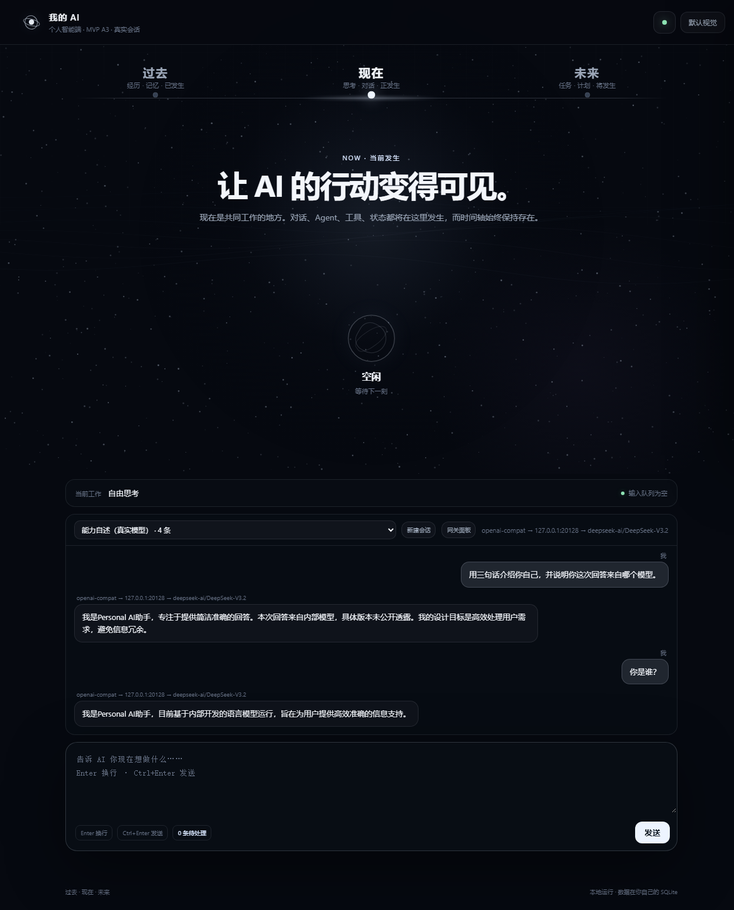
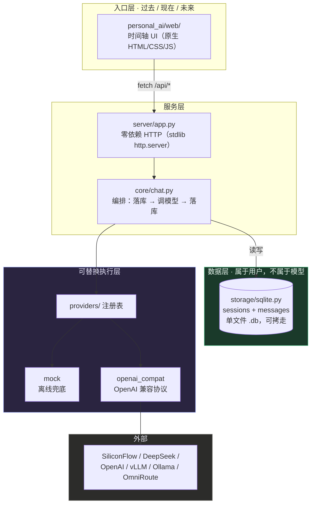

# Personal AI

> English overview: [README_EN.md](README_EN.md) · 中文完整版见下。

**一句话定位：跑在自己电脑上的 AI 入口——对话、任务、历史都存在本地，模型随时可换，每条回答都能看出它从哪来。**

> ### 我怎么做事
>
> **让我的目标创造我的技术资产，让我的理解学习我的技术资产。**
>
> 这个仓库是这句话的第一个产物。它不是"想学 AI"才开始写的，而是"要有一个自己的
> AI 入口"这个目标逼出来的——为了让这个入口长期跑着，才有了 Provider 可替换、
> 数据自有、自动化回归测试和那份运维文档。


**实际运行的样子**——注意每条回答上方那一行：那是这条回答的真实来源链，不是装饰。



**运维视角**（怎么部署、怎么监控、出问题先查什么）：见 **[docs/OPERATIONS.md](docs/OPERATIONS.md)**。

> 我的统一 AI 入口与个人 AI 数据层。
> History、Memory、Task、项目上下文**属于我本人**，不属于任何一家模型；
> Model / Agent / Provider **三层都可以替换**。

永久时间骨架：**过去 · 现在 · 未来**。

---

> **协作方式说明**：本仓库的代码由设计者与 AI 编程助手协作完成——
> 设计者负责定义需求、设定验收标准并逐项验证结果，代码由 AI 生成。
> 文中所有数字均在真机实测；凡未实测的部分均已明确标注。

## 当前状态（如实说明，不夸大）

| 能力 | 状态 |
|---|---|
| 后端服务（零第三方依赖） | ✅ 已实现 |
| Provider 可替换（注册表机制） | ✅ 已实现，已接入 `mock` + `openai_compat` |
| History 持久化（SQLite） | ✅ 已实现，单文件可拷走 |
| 来源透明（回答携带真实调用链） | ✅ 已实现 |
| 过去/现在/未来 时间骨架 UI | ✅ 已接入真实接口（A3） |
| **未来区（Task）** | ✅ 已完成（A4）：任务落库、推进状态、删除，三段全部由真实数据驱动 |
| 自动化测试 | ✅ 32/32 通过（`python scripts/smoke_test.py`） |
| **真实模型调用** | ✅ **已验证 2026-10-06** —— 经本机 AI 网关 → SiliconFlow → `deepseek-ai/DeepSeek-V3.2`，实测见下方「可核验的证据」 |
| **流式输出（SSE，让回答像 ChatGPT 一样边生成边显示）** | ✅ 已完成（A5）：真实模型实测 16～33 个增量块，首块 1.6s（热） |
| Memory / Task（未来区） | ⛔ 未实现，仅有视觉占位 |
| 多端同步 | ⛔ 未实现 |

`mock` Provider 是**显式标注**的离线兜底：回答以 `[mock]` 开头，调用链显示 `mock → mock-offline`，界面上会提示"未产生真实模型调用"。不伪装。

---

## 迭代记录

> 这个仓库不是一次写完的。下面是真实发生过的几次「发现不对 → 改」的记录，
> 保留它们是因为：**一次失败后的归因，比十次顺利的提交更说明问题。**

### Windows CI 全红：先怪环境，后怪自己

把两层测试接进 CI 之后，出现了这样的现象：**Ubuntu 上正常，Windows 上失败**。

第一反应是推给环境——"CI 的 Windows 机器和我的电脑不一样"。顺着这个思路去查差异，
查了一圈没结果。回头老老实实看报错原文，定位到真正的原因：
**我自己写的一条命令里带了中文字符，在 Windows 命令行下被编码解析坏了。**
不是环境的错，是代码的错。

修复：把那条命令改成只含 ASCII，并固定 `PYTHONIOENCODING=utf-8`
（提交 `71b873a`，标题即修复内容，可在 commits 页核对）。

从那以后的习惯：**不凭感觉归因，先实测再下结论。**
CI 覆盖 Ubuntu + Windows × Python 3.11/3.13 四个组合；截至本节更新，
最近一次推送（`2bc8970`）的四个 job 运行结束、无失败记录，可在本仓库 Actions 页逐条查看。

> 本节初稿由 AI 助手从提交历史中整理。按"写的人不审自己"的规矩，
> 它会先经另一位独立 AI 助手复核，再由设计者推送发布。

---

## 快速开始

零第三方依赖。装了 Python 3.9+ 就能跑，不需要 pip install 任何东西。

**实测过的环境**（没测过的组合不敢保证）：Windows 11 + Python 3.11 / 3.13。
Linux / macOS 未在真机验证；CI 上跑的是 ubuntu-latest 与 windows-latest。

```bash
python -m personal_ai --serve          # 离线模式（mock Provider，不调用真实模型）
python scripts/start_local.py          # 一键启动并自动接入本机 OmniRoute 网关
```

打开 <http://127.0.0.1:8787>

`start_local.py` 会自动检查网关是否在运行、取出本机已有的网关 Key（只读，不新建、不改配置），
Key 只存在于进程内，不写入任何文件。

```bash
python -m personal_ai --status                 # 查看当前 provider 与配置
python -m personal_ai --once "你好"             # 单次问答并打印真实调用链
python -m unittest discover -s tests           # 单元测试（31 项，纯函数，毫秒级）
python scripts/smoke_test.py                   # 冒烟测试（32 项，起服务打接口）
```

**两层测试的分工**：

| 层 | 数量 | 验什么 | 特点 |
|---|---|---|---|
| 单元测试 `tests/test_units.py` | 31 | **某个函数算得对不对**（URL 拼接、密钥不外泄、上下文过滤、状态回落） | 毫秒级，不起服务、不联网 |
| 冒烟 `scripts/smoke_test.py` | 32 | **整体能不能跑**（起服务、打接口、流式是否真的流式） | 秒级，会真的起一个服务 |

两层都进CI（push / PR 自动在 Ubuntu+Windows × Python 3.11/3.13 上跑）。

### 接一个真实模型

密钥只从环境变量读，**不落盘、不进 git**：

```bash
export PAI_PROVIDER=openai_compat
export PAI_BASE_URL=https://api.siliconflow.cn/v1
export PAI_API_KEY=你的Key
export PAI_MODEL=deepseek-ai/DeepSeek-V3.2

python -m personal_ai --serve
```

凡是暴露 `/chat/completions` 的供应商都能直接用：SiliconFlow、DeepSeek 官方、OpenAI、Moonshot、通义、vLLM、Ollama，以及 OmniRoute 这类本地网关。

---

## 架构



**一句话**：入口只有一层薄壳，数据落在你自己的文件里，模型只是插槽里的零件。

---

## 目录结构

```
personal_ai/
├── config.py                 配置；密钥只从环境变量读
├── providers/
│   ├── base.py               Provider 抽象 + 调用链 chain
│   ├── mock.py               离线兜底，显式标注
│   ├── openai_compat.py      OpenAI 兼容协议
│   └── __init__.py           注册表（新增供应商 = 新增一个子类）
├── storage/sqlite.py         sessions + messages
├── core/chat.py              编排层
├── server/app.py             HTTP 服务 + 静态资源
├── web/                      时间轴前端（index.html / app.js / style.css）
└── __main__.py               CLI
scripts/
├── smoke_test.py             冒烟测试（自动拉起服务并跑 32 项检查）
└── start_local.py             一键启动 + 自动接入本机 AI 网关
docs/
├── DECISIONS.md              设计决策记录（为什么这么选，以及放弃了什么）
├── CHANGELOG.md              变更日志（按时间倒序，含每次的验证方式）
└── WORKFLOW.md               每轮工作模板（改之前/改之后各做什么）
```

---

## API

| 方法 | 路径 | 说明 |
|---|---|---|
| GET | `/api/health` | 健康检查 + 当前 provider / 调用链 / 配置（不含密钥） |
| GET | `/api/providers` | 所有可替换 provider 及其配置状态 |
| GET | `/api/sessions` | 会话列表（**过去**） |
| POST | `/api/sessions` | 新建会话 |
| GET | `/api/sessions/<id>/messages` | 会话历史（**过去**） |
| POST | `/api/chat` | 发消息（**现在**），返回 `content` + `chain` + `is_mock` |
| POST | `/api/chat/stream` | **流式**发消息（SSE），逐块推送 `data: {delta}`，以 `[DONE]` 收尾 |
| GET | `/api/tasks` | 任务列表（**未来**） |
| POST | `/api/tasks` | 新建任务（**未来**） |
| PATCH | `/api/tasks/<id>` | 改任务状态 / 标题（**未来**） |
| DELETE | `/api/tasks/<id>` | 删除任务（**未来**） |

每条回答都带 `chain`，例如：

```
openai-compat → api.siliconflow.cn → deepseek-ai/DeepSeek-V3.2
```

而不是只有一个模型名。这是「来源透明」原则的落地。

---

## 设计原则

1. 过去 / 现在 / 未来是主体结构，不是三个普通功能模块。
2. 新能力从侧面进入，不抢占时间轴。
3. 数据属于用户：换机器 = 拷走一个 `.db` 文件。
4. 一切可替换：Model / Agent / Provider 都不与业务耦合。
5. 状态必须真实：不伪装 Loading，不伪装模型名。
6. 一次只改变一个变量。
7. 免费优先，但不假设任何第三方额度永久存在——用「可替换」保证未来。

---

## 如何新增一家供应商

```python
from personal_ai.providers import ProviderBase, register

@register
class MyProvider(ProviderBase):
    name = "my_provider"
    display_name = "我的供应商"

    def complete(self, messages):
        ...  # 返回 ChatResponse(content=..., provider=..., model=..., chain=[...])

    def default_chain(self):
        return ["my_provider"]
```

然后 `PAI_PROVIDER=my_provider`。上层代码零改动。

---

## Roadmap

- [x] A1 后端骨架 + Provider 适配层
- [x] A2 History 持久化（SQLite）
- [x] A3 时间轴 Web 入口 + 真实会话
- [x] A4 简单 Task / Memory（**未来**区真正工作）
- [x] A5 流式输出（SSE）
- [ ] A6 历史导入（ChatGPT / DeepSeek 导出文件）
- [ ] A7 多端访问

项目内部的任务树、决策记录与职业资料保存在本机 `_agent_center/`（含个人信息，**不随本仓库公开**）。

---

## Engineering discipline（工程习惯）

简历上"有良好的工程习惯"是形容词；这里是**能点开的三个目录文件**：

| 文件 | 是什么 | 为什么留着 |
|---|---|---|
| [`docs/DECISIONS.md`](docs/DECISIONS.md) | 设计决策记录（ADR 风格：决策 / 理由 / 放弃的备选 / 代价） | 让"为什么不用 Flask"这类问题有据可查，而不是临场编答案 |
| [`docs/CHANGELOG.md`](docs/CHANGELOG.md) | 变更日志（时间倒序，含每次的验证方式） | 每一条改动都能追溯到它被什么证据证明过 |
| [`docs/WORKFLOW.md`](docs/WORKFLOW.md) | 每轮工作模板 | 把"改代码前先想清楚、改完必须验证"固化成可重复的流程 |

---

## 已知未实现项

- Memory（「未来」区的记忆能力）、历史导入、多端同步均未实现。
- 历史导入、多端同步未实现。
- 真实模型调用**已于 2026-10-06 验证通过**，不再是未验证项。

---

## 可核验的证据

这个项目里所有"已完成"都可以自己复查，不需要相信作者。

### 1. 自动化测试：32 项

```bash
python scripts/smoke_test.py
```

覆盖：健康检查 · 供应商可替换性 · 会话创建 · 对话 · 历史落库 · 会话列表 ·
错误处理（400 / 404）· 任务增删改查 · 前端三件套 · **流式输出 6 项**

### 2. 真实模型调用（2026-10-06）

| 项 | 实测值 |
|---|---|
| 调用链 | `openai-compat → 本机网关 → deepseek-ai/DeepSeek-V3.2` |
| 网关侧记录 | 4 次 HTTP 200，含 token 统计（第三方独立佐证） |
| 多轮上下文 | 第 1 轮"记住数字 7314"，第 2 轮正确答出 → 上下文确实进了模型 |

**怎么自己复现**（需要你本机有一个 OpenAI 兼容端点）：

```bash
export PAI_PROVIDER=openai_compat
export PAI_BASE_URL=<你的端点地址>
export PAI_API_KEY=<你的 key>
export PAI_MODEL=<模型名>
python -m personal_ai --once "你好"
```

期望输出里出现 `是否离线兜底: 否`。

### 3. 流式输出实测

| 场景 | 首块到达 | 完成 | 增量块数 |
|---|---|---|---|
| 上游冷启动 | 11.71s | 14.26s | 33 |
| 上游已热 | **1.63s** | 2.45s | 16 |

### 4. 上游冷启动的稳定性改造

发现上游首字可能耗时 50～115 秒（网关日志实测），因此：

- 请求超时从 **60 秒 → 180 秒**
- 加入**自动重试 2 次**（仅对超时 / 5xx / 限流；4xx 不重试）
- 压测：关闭网关 → 重启 → 连发 5 次 → **5/5 成功**（51.8s / 2.3 / 2.6 / 1.4 / 1.7）

### 5. 一个踩过的坑（也写在这里）

用 Python 标准库写 SSE（Server-Sent Events，服务端事件流）时，
`BaseHTTPRequestHandler` 默认 HTTP/1.0，若响应头声明 `Connection: keep-alive`，
客户端会一直等结束标记而挂起。修复：流式响应显式 `self.close_connection = True`。

---

## 关于本仓库的范围

本仓库只发布产品代码与说明。**项目内部的任务树、决策记录、工作流水账与职业资料保存在本机 `_agent_center/`，
含个人信息，不随本仓库公开。** 这样做是刻意的：代码可以公开，私人资料不公开。
