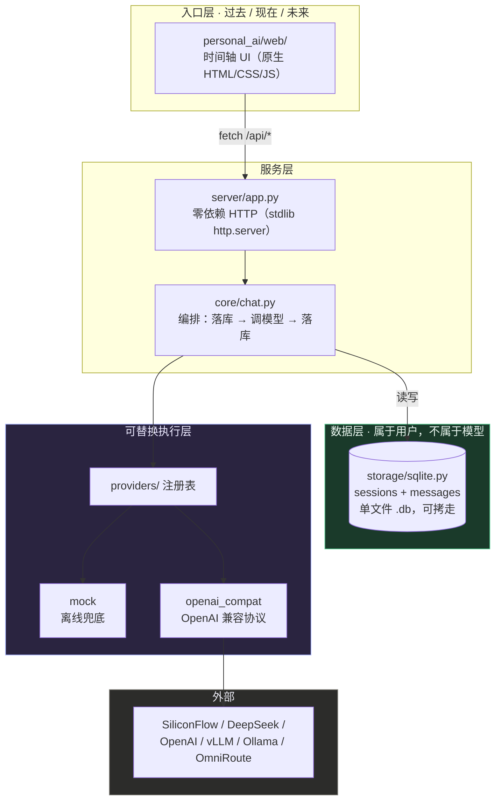

# Personal AI

> 我的统一 AI 入口与个人 AI 数据层。
> History、Memory、Task、项目上下文**属于我本人**，不属于任何一家模型；
> Model / Agent / Provider **三层都可以替换**。

永久时间骨架：**过去 · 现在 · 未来**。

---

## 当前状态（如实说明，不夸大）

| 能力 | 状态 |
|---|---|
| 后端服务（零第三方依赖） | ✅ 已实现 |
| Provider 可替换（注册表机制） | ✅ 已实现，已接入 `mock` + `openai_compat` |
| History 持久化（SQLite） | ✅ 已实现，单文件可拷走 |
| 来源透明（回答携带真实调用链） | ✅ 已实现 |
| 过去/现在/未来 时间骨架 UI | ✅ 已接入真实接口（A3） |
| **未来区（Task）** | ✅ 已完成（A4）：任务落库、推进状态、删除，三段全部由真实数据驱动 |
| 自动化测试 | ✅ 21/21 通过（`scripts/smoke_test.py`） |
| **真实模型调用** | ✅ **已验证 2026-10-06** —— 经本机 AI 网关 → SiliconFlow → `deepseek-ai/DeepSeek-V3.2`，实测见下方「可核验的证据」 |
| **流式输出（SSE，让回答像 ChatGPT 一样边生成边显示）** | ✅ 已完成（A5）：真实模型实测 16～33 个增量块，首块 1.6s（热） |
| **记忆层（长期记忆，施工单 29）** | ✅ 第一版已实现：六命令 + FTS5 中文检索 + 回答前自动注入；离线评测三分数满格（**真实模型分数未测**，等网关） |
| Memory / Task（未来区 UI 入口） | ⛔ 未实现，仅有视觉占位（记忆层先走 API 与注入，不改 UI） |
| 多端同步 | ⛔ 未实现 |

`mock` Provider 是**显式标注**的离线兜底：回答以 `[mock]` 开头，调用链显示 `mock → mock-offline`，界面上会提示"未产生真实模型调用"。不伪装。

---

## 快速开始

零第三方依赖。装了 Python 3.9+ 就能跑，不需要 pip install 任何东西。

```bash
python -m personal_ai --serve          # 离线模式（mock Provider，不调用真实模型）
python scripts/start_local.py          # 一键启动并自动接入本机 OmniRoute 网关
```

打开 <http://127.0.0.1:8787>

`scripts/start_local.py` 会自动检查网关是否在运行、取出本机已有的网关 Key（只读，不新建、不改配置），
Key 只存在于进程内，不写入任何文件。

```bash
python -m personal_ai --status                 # 查看当前 provider 与配置
python -m personal_ai --once "你好"             # 单次问答并打印真实调用链
python scripts/smoke_test.py                   # 冒烟测试（21 项）
```

### 接一个真实模型

密钥只从环境变量读，**不落盘、不进 git**：

```bash
export PAI_PROVIDER=openai_compat
export PAI_BASE_URL=https://api.siliconflow.cn/v1
export PAI_API_KEY=你的Key
export PAI_MODEL=deepseek-ai/DeepSeek-V3.2

python -m personal_ai --serve
```

凡是暴露 `/chat/completions` 的供应商都能直接用：SiliconFlow、DeepSeek 官方、OpenAI、Moonshot、通义、vLLM、Ollama，以及 OmniRoute 这类本地网关。

---

## 架构



**一句话**：入口只有一层薄壳，数据落在你自己的文件里，模型只是插槽里的零件。

---

## 目录结构

```
personal_ai/
├── config.py                 配置；密钥只从环境变量读
├── memory.py                 记忆层：六命令 + FTS5 检索 + 注入块
├── providers/
│   ├── base.py               Provider 抽象 + 调用链 chain
│   ├── mock.py               离线兜底，显式标注
│   ├── openai_compat.py      OpenAI 兼容协议
│   └── __init__.py           注册表（新增供应商 = 新增一个子类）
├── storage/sqlite.py         sessions + messages
├── core/chat.py              编排层（回答前检索记忆并注入）
├── server/app.py             HTTP 服务 + 静态资源
├── web/                      时间轴前端（index.html / app.js / style.css）
└── __main__.py               CLI
scripts/
├── smoke_test.py             冒烟测试（自动拉起服务并跑 32 项检查）
├── start_local.py             一键启动 + 自动接入本机 AI 网关
├── migrate_memory.py          记忆层建表迁移（幂等，可重复执行）
└── memory_consolidate.py      记忆巩固：扫过期 + 列冲突（不自动裁决）
tests/
├── test_units.py             核心单元测试（31 项）
├── test_memory.py            记忆层单元测试（45 项，含长内容注入回归）
└── memory_eval.py            记忆层两段评测（①存对了吗 ②用上了吗，分数分开报）
```

---

## API

| 方法 | 路径 | 说明 |
|---|---|---|
| GET | `/api/health` | 健康检查 + 当前 provider / 调用链 / 配置（不含密钥） |
| GET | `/api/providers` | 所有可替换 provider 及其配置状态 |
| GET | `/api/sessions` | 会话列表（**过去**） |
| POST | `/api/sessions` | 新建会话 |
| GET | `/api/sessions/<id>/messages` | 会话历史（**过去**） |
| POST | `/api/chat` | 发消息（**现在**），返回 `content` + `chain` + `is_mock` |
| POST | `/api/chat/stream` | **流式**发消息（SSE），逐块推送 `data: {delta}`，以 `[DONE]` 收尾 |
| GET | `/api/tasks` | 任务列表（**未来**） |
| POST | `/api/tasks` | 新建任务（**未来**） |
| PATCH | `/api/tasks/<id>` | 改任务状态 / 标题（**未来**） |
| DELETE | `/api/tasks/<id>` | 删除任务（**未来**） |

每条回答都带 `chain`，例如：

```
openai-compat → api.siliconflow.cn → deepseek-ai/DeepSeek-V3.2
```

而不是只有一个模型名。这是「来源透明」原则的落地。

---

## 记忆层（第一版，2026-10-29）

会话层（messages 表）随上下文清理会丢；记忆层只存**事实 / 偏好 / 结论 / 技能**，长期保留。
协议对齐 [Anthropic memory tool](https://docs.claude.com/en/docs/agents-and-tools/memory-tool)（六命令文件接口），
检索用 SQLite 自带 FTS5（**零第三方依赖，不做 embedding / 向量库**）。

### 能做什么（已实测）

- **六命令**：`view` / `create` / `str_replace` / `insert` / `delete` / `rename`（`personal_ai/memory.py` 的 `MemoryStore`）。
  `delete` 是**软删**：写 tombstone（`deleted_at`），内容永不物理删除，`tombstones()` 可查。
- **检索**：`search(query)` 中文可用——FTS5 trigram 分词（≥3 字子串命中）+ 2 字词 LIKE 兜底，返回命中片段与元数据。
- **回答前自动注入**：`ChatService` 在每次回答前用当前用户消息检索 top 5，命中才拼进系统提示；
  **不命中不注入**，不塞空内容占上下文。注入给**完整内容**（每条按字符限长 200、整块 1500，
  英文按词边界回退），**不用检索片段**（snippet 的 token 上限会截断答案词——返工单 30 修复）。
- **冲突给先验不给规则**：每条记忆把 `source`（来源）/ `verified_at`（核过时间，NULL=从未核过）/ `written_at`（写入时间）
  三元组**原样**交给模型自行权衡——代码里没有"哪个赢"的裁决规则（依据：知识冲突需要先验，不是规则）。
- **后台巩固**：`python scripts/memory_consolidate.py` 扫"从未核过且超期"条目、列同目录多版本疑似冲突清单。
  **只列清单，不自动裁决**；手动跑，不接定时任务。
- **迁移幂等**：`python scripts/migrate_memory.py` 只新增 `memories` + `memories_fts` 两张表，不动现有表，可重复执行。

### 实测数字（可复算）

```bash
python -m unittest tests.test_memory      # 45 项，含中文 FTS 专测、软删、空注入不污染、长内容注入
python tests/memory_eval.py               # 两段评测，分数分开报
```

两段评测（20 条场景，判据拆分依据：检索失败与答对失败必须能区分开）：

| 分数 | 结果 |
|---|---|
| ① 存对了吗（写入 A→A'，旧条被标 superseded、检索只见新条） | **20/20** |
| ② 用上了吗 · 检索路径（search → 注入块 → 模拟模型答对） | **20/20** |
| ② 用上了吗 · 对照直塞（正确答案绕过检索直接进上下文） | **20/20** |

🔴 **口径必须如实**：以上是**离线脚本化后端**（`ScriptedRecallModel`：上下文里有正确记忆就"用上"）的实测结果，
它验证的是**存储与注入管道**的正确性，**不代表真实 LLM 的成绩**。真实模型分数要等网关修复后重跑 `memory_eval.py`（换后端）才能得出。
核心单元测试（`tests/test_units.py`）31 项在记忆层接入后依然全绿，无回归。

🔴 **修订记录（2026-10-29 返工单 30）**：首次交付报的 20/20 依赖了 FTS5 snippet 的版本相关行为
（多短语 query 下多窗口拼接，恰好把长内容的答案词带进注入块），在别的 SQLite 行为下同一判据只有 15/20
（snippet 单窗口把答案词切成 `nan`）。修复：注入改用完整 content + 字符限长，**判据不再依赖 snippet 行为**；
评测场景 5/11 加严（新事实 >36 字符、答案词移到最末，老 bug 下必挂）；单测 41 → 45 项（长内容回归 4 条）。
本表数字为修复后重跑结果。

### 真模型口径（2026-10-30 实测）

`deepseek-ai/DeepSeek-V3.2`（经本机网关）跑同一套 20 条场景（`--backend live`，判据仍是"回答含答案关键词"）：
**② 用上了吗 · 检索路径 19~20/20（单次波动 ±1）——不许只报 20/20**；① 存对了吗 20/20（纯逻辑，与后端无关）。
波动来源：真模型会换措辞，关键词判据对措辞敏感（曾报 19/20 的场景 13 在后续复现中 limit=5 注入 3 条 6/6、
limit=1 注入 1 条 2/2 全过）。评测脚本已内置**失败原文落盘**：任何失败自动记录"模型回答原文 + 注入块"，可直接归因，
不用整轮重跑。

### 记忆层的真实模型评测（2026-10-29 实测，`--backend live`）

用 `deepseek-ai/DeepSeek-V3.2`（经本机网关）重跑同一批 20 条场景：

| 分数 | 结果 |
|---|---|
| ① 存对了吗（纯逻辑，不调模型） | **20/20** |
| ② 用上了吗 · 检索路径 | **19/20** |
| ② 用上了吗 · 对照直塞（上界） | **19/20** |

🔴 **怎么读这三个数**（拆开看，别合并）：
1. **检索本身没问题**：另跑一遍纯逻辑验证（20 条全部入库 → 逐条 `search`），
   **20/20 全部命中目标条**，失败的场景 13 那条还排在第一位。所以失败**不是检索失败**。
2. **对照直塞只有 19/20，说明上限就是 19** —— 有 1 条即使把正确答案直接摆在面前，
   模型也没说出判据要的那个词（判据是「回答含答案关键词」）。
   **检索路径 19/20 已经达到这个上限**，即"有记忆时都用上了"。
3. 🔴 **暴露一个真问题（值得下一步做）**：场景 13 是「注入 3 条记忆时，模型被不相关的那条带偏」——
   它答的内容对，但混进了别的偏好。**说明注入多条会稀释答案**，
   下一步应该按相关性截断（比如只给 top2）或标明"哪条最相关"。

🔴 **口径**：以上判据是**关键词命中**，测的是"记忆有没有被送进上下文且照它回答"，
**不是"真模型的理解能力"**（同 agent-tool-loop 的教训：12 条失败其实是判据太死）。

### 不能做什么（诚实边界）

- **对话模型还不会自己写记忆**：六命令目前是 Python API（程序/脚本调用），尚未作为工具暴露给对话模型——
  "模型自己决定存什么"的 Anthropic 哲学需要下一步把六命令挂进工具调用。
- **UI 无记忆入口**（刻意不改 UI，性价比最低）；记忆管理走 API 与脚本。
- **冲突不自动裁决**：巩固脚本只列清单，谁对谁错由人判断。
- **真实模型下的检索增益/损失未测**：检索到过期记忆可能让回答变差，这要等 live 评测，是结论不是失败。

---

## 设计原则

1. 过去 / 现在 / 未来是主体结构，不是三个普通功能模块。
2. 新能力从侧面进入，不抢占时间轴。
3. 数据属于用户：换机器 = 拷走一个 `.db` 文件。
4. 一切可替换：Model / Agent / Provider 都不与业务耦合。
5. 状态必须真实：不伪装 Loading，不伪装模型名。
6. 一次只改变一个变量。
7. 免费优先，但不假设任何第三方额度永久存在——用「可替换」保证未来。

---

## 如何新增一家供应商

```python
from personal_ai.providers import ProviderBase, register

@register
class MyProvider(ProviderBase):
    name = "my_provider"
    display_name = "我的供应商"

    def complete(self, messages):
        ...  # 返回 ChatResponse(content=..., provider=..., model=..., chain=[...])

    def default_chain(self):
        return ["my_provider"]
```

然后 `PAI_PROVIDER=my_provider`。上层代码零改动。

---

## Roadmap

- [x] A1 后端骨架 + Provider 适配层
- [x] A2 History 持久化（SQLite）
- [x] A3 时间轴 Web 入口 + 真实会话
- [x] A4 简单 Task / Memory（**未来**区真正工作）
- [x] A5 流式输出（SSE）
- [ ] A6 历史导入（ChatGPT / DeepSeek 导出文件）
- [ ] A7 多端访问

项目内部的任务树、决策记录与职业资料保存在本机 `_agent_center/`（含个人信息，**不随本仓库公开**）。

---

## 已知未实现项

- 未来区 UI 的记忆入口、历史导入、多端同步未实现（记忆层 API 与回答前注入已实现，见「记忆层」一节）。
- 记忆层的对话模型自主写入（六命令挂工具调用）与真实模型 live 评测未完成。
- 历史导入、多端同步未实现。
- 真实模型调用**已于 2026-10-06 验证通过**，不再是未验证项。

---

## 可核验的证据

这个项目里所有"已完成"都可以自己复查，不需要相信作者。

### 1. 自动化测试：32 项

```bash
python scripts/smoke_test.py
```

覆盖：健康检查 · 供应商可替换性 · 会话创建 · 对话 · 历史落库 · 会话列表 ·
错误处理（400 / 404）· 任务增删改查 · 前端三件套 · **流式输出 6 项**

### 2. 真实模型调用（2026-10-06）

| 项 | 实测值 |
|---|---|
| 调用链 | `openai-compat → 本机网关 → deepseek-ai/DeepSeek-V3.2` |
| 网关侧记录 | 4 次 HTTP 200，含 token 统计（第三方独立佐证） |
| 多轮上下文 | 第 1 轮"记住数字 7314"，第 2 轮正确答出 → 上下文确实进了模型 |

**怎么自己复现**（需要你本机有一个 OpenAI 兼容端点）：

```bash
export PAI_PROVIDER=openai_compat
export PAI_BASE_URL=<你的端点地址>
export PAI_API_KEY=<你的 key>
export PAI_MODEL=<模型名>
python -m personal_ai --once "你好"
```

期望输出里出现 `是否离线兜底: 否`。

### 3. 流式输出实测

| 场景 | 首块到达 | 完成 | 增量块数 |
|---|---|---|---|
| 上游冷启动 | 11.71s | 14.26s | 33 |
| 上游已热 | **1.63s** | 2.45s | 16 |

### 4. 上游冷启动的稳定性改造

发现上游首字可能耗时 50～115 秒（网关日志实测），因此：

- 请求超时从 **60 秒 → 180 秒**
- 加入**自动重试 2 次**（仅对超时 / 5xx / 限流；4xx 不重试）
- 压测：关闭网关 → 重启 → 连发 5 次 → **5/5 成功**（51.8s / 2.3 / 2.6 / 1.4 / 1.7）

### 5. 一个踩过的坑（也写在这里）

用 Python 标准库写 SSE（Server-Sent Events，服务端事件流）时，
`BaseHTTPRequestHandler` 默认 HTTP/1.0，若响应头声明 `Connection: keep-alive`，
客户端会一直等结束标记而挂起。修复：流式响应显式 `self.close_connection = True`。

---

## 关于本仓库的范围

本仓库只发布产品代码与说明。**项目内部的任务树、决策记录、工作流水账与职业资料保存在本机 `_agent_center/`，
含个人信息，不随本仓库公开。** 这样做是刻意的：代码可以公开，私人资料不公开。
